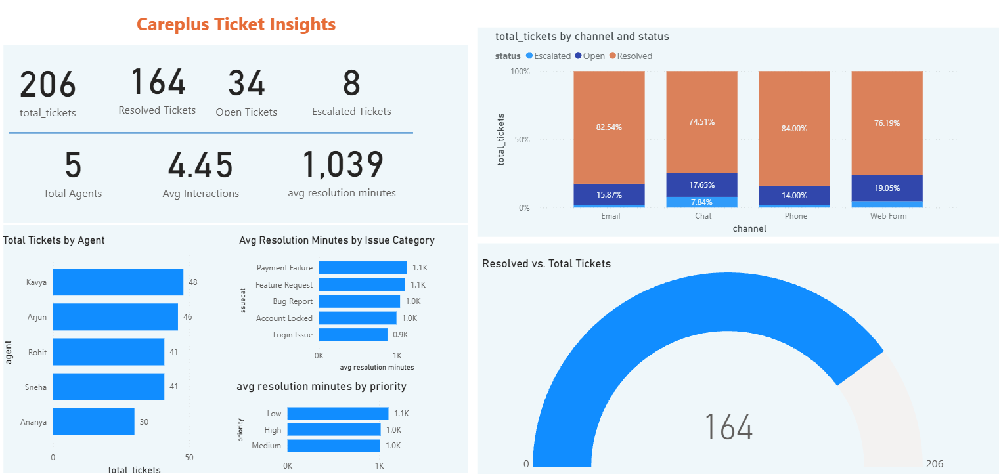
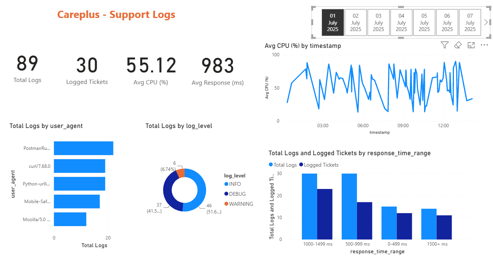

<div align="center">

# CarePlus — Serverless AWS ETL Pipeline

**An event-driven, incremental Data Engineering pipeline built on AWS that extracts operational support data, transforms it into Apache Parquet using serverless AWS Lambda functions, loads it into Amazon Redshift Serverless, and powers interactive Power BI dashboards.**

<p align="center">
  
  
  
  
  
  
  
  
  
  
</p>

</div>

---

## Architecture

```text
  MySQL (support_tickets)          Application Server Logs (*.log)
            │                                    │
            │  Incremental Daily Ingestion       │
            │  (date trackers + StringIO)        │
            ▼                                    ▼
┌────────────────────────────────────────────────────────────────┐
│                Amazon S3 — Raw Layer (Bronze)                  │
│   support-tickets/raw/*.csv         support-logs/raw/*.log     │
└──────────────┬──────────────────────────────────┬──────────────┘
               │ S3 ObjectCreated Trigger         │ S3 ObjectCreated Trigger
               ▼                                  ▼
┌─────────────────────────────┐    ┌─────────────────────────────┐
│ AWS Lambda (Tickets ETL)    │    │ AWS Lambda (Logs ETL)       │
│ lambda_process_tickets.py   │    │ lambda_process_logs.py      │
│ • Clean typos & nulls       │    │ • Multi-line Regex parsing  │
│ • Filter negative outliers  │    │ • Standardize log levels    │
│ • Convert to Parquet        │    │ • Convert to Parquet        │
└──────────────┬──────────────┘    └──────────────┬──────────────┘
               │                                  │
               ▼                                  ▼
┌────────────────────────────────────────────────────────────────┐
│             Amazon S3 — Processed Layer (Silver)               │
│ support-tickets/processed/*.parquet                            │
│ support-logs/processed/*.parquet                               │
└──────────────────────────────┬─────────────────────────────────┘
                               │ Bulk Load via Redshift COPY
                               │ (sql/create_tables.sql)
                               ▼
┌────────────────────────────────────────────────────────────────┐
│          Amazon Redshift Serverless — Analytics (Gold)         │
│         public.support_tickets   |   public.support_logs       │
└──────────────────────────────┬─────────────────────────────────┘
                               │
                               ▼
                    Power BI Dashboards
```

---

## Tech Stack

| Layer | Technologies |
| :--- | :--- |
| **Source & Ingestion** |     |
| **Storage (Data Lake)** |   |
| **Serverless Transformation** |    |
| **Data Warehouse & BI** |   |

---

## Key Features & Transformations

* **Incremental Daily Ingestion:** Stateful Python scripts track high-water marks (`date_tracker.txt`, `log_date_tracker.txt`) and stream daily deltas from MySQL and local server logs directly to S3 in memory (`StringIO`).
* **Serverless Log Transformation (`lambda_process_logs.py`):** Automatically triggered by S3 uploads to parse multi-line `.log` files with Regex, normalize malformed log levels (`INF0` → `INFO`, `DEBG` → `DEBUG`, `warnING` → `WARNING`, `EROR` → `ERROR`), drop `trace_id`, filter negative response times, deduplicate rows, and write `datetime64[ms]` Parquet files in memory (`BytesIO`).
* **Serverless Ticket Transformation (`lambda_process_tickets.py`):** Event-driven AWS Lambda function that cleans raw support ticket CSVs—fixing priority typos (`Lw` → `Low`, `Hgh` → `High`, `Medum` → `Medium`), dropping null `ticket_id` rows and empty columns (`agent_feedback`), filtering corrupted negative interactions (`-999999`), standardizing timestamps, and writing compressed Parquet files to S3.
* **Warehouse Schema & Bulk Loading (`sql/create_tables.sql`):** Defines Redshift target schemas (`public.support_tickets` and `public.support_logs`) and bulk-loads Snappy-compressed Parquet files directly from S3 using native parallel `COPY` commands.

---

## Power BI Dashboards

### 1. CarePlus Ticket Insights
<p align="center">
  
</p>

* Tracks **206 total tickets** (**164 Resolved**, **34 Open**, **8 Escalated**) across **5 support agents** with a **Resolved vs. Total Tickets** progress gauge.
* Monitors **4.45 avg interactions** and **1,039 avg resolution minutes** broken down by issue category (`Payment Failure`, `Feature Request`, `Bug Report`, `Account Locked`, `Login Issue`) and cleaned priorities (`High`, `Medium`, `Low`).
* Highlights channel efficiency—**Phone (84.00%)** and **Email (82.54%)** lead resolution rates, while **Chat** records the highest escalation rate (**7.84%**).

### 2. CarePlus Support Logs
<p align="center">
  
</p>

* Interactive daily telemetry view (e.g., `01 July 2025`: **89 cleaned logs**, **30 logged tickets**, **55.12% avg CPU**, **983 ms avg response time**).
* Visualizes standardized log-level distribution (**INFO 51.6%**, **DEBUG 41.5%**, **WARNING 6.74%**), CPU usage over time, user-agent traffic, and response-time latency buckets.

---

## Project Structure

```text
care-plus-etl-aws/
├── docs/
│   ├── dashboard_tickets.png          # Ticket Insights Power BI screenshot
│   └── dashboard_logs.png             # Support Logs Power BI screenshot
├── src/
│   ├── ingestion/
│   │   ├── ingest_tickets.py          # Incremental MySQL -> S3 raw CSV
│   │   └── ingest_logs.py             # Incremental local logs -> S3 raw
│   └── transformation/
│       ├── lambda_process_logs.py     # AWS Lambda: Regex log ETL -> Parquet
│       └── lambda_process_tickets.py  # AWS Lambda: Ticket cleaning -> Parquet
├── sql/
│   └── create_tables.sql              # Redshift DDL schemas & S3 Parquet COPY commands
├── requirements.txt
└── .gitignore
```

---

## Quick Start

1. **Clone & install dependencies**
   ```bash
   git clone [https://github.com/vivekrokadi/care-plus-etl-aws.git](https://github.com/vivekrokadi/care-plus-etl-aws.git)
   cd care-plus-etl-aws
   python -m venv venv
   venv\Scripts\activate  # macOS/Linux: source venv/bin/activate
   pip install -r requirements.txt
   ```

2. **Configure environment variables** — Create a `.env` file in the root directory:
   ```env
   AWS_ACCESS_KEY_ID="your_access_key"
   AWS_SECRET_ACCESS_KEY="your_secret_key"
   AWS_REGION="ap-southeast-2"
   S3_BUCKET="care-plus-datalake"

   MYSQL_HOST="localhost"
   MYSQL_USER="your_mysql_user"
   MYSQL_PASSWORD="your_mysql_password"
   MYSQL_DATABASE="careplus"
   ```

3. **Deploy & execute**
   * Deploy `lambda_process_logs.py` and `lambda_process_tickets.py` on AWS Lambda (`Python 3.14`, `x86_64`, `256 MB` RAM, `AWSSDKPandas-Python314` layer) with S3 `ObjectCreated` triggers.
   * Run the incremental ingestion scripts:
     ```bash
     python src/ingestion/ingest_tickets.py
     python src/ingestion/ingest_logs.py
     ```
   * Run `sql/create_tables.sql` in the Amazon Redshift Serverless Query Editor (replacing `<AWS_ACCOUNT_ID>` and `<REDSHIFT_ACCESS_ROLE>` with your IAM role ARN) to create the tables and bulk-load the processed Parquet files from S3.

---